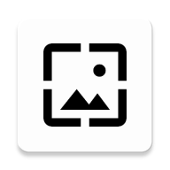

# Onyx Boox C69 M Star — Screensaver Shortcut

A minimal Android wrapper app that directly opens the hidden Onyx Screensaver Manager on the **Onyx Boox C69_M_Star** and immediately closes itself.

## Screenshots

| App Icon | Screensaver Manager |
| :---: | :---: |
|  |  |


## Installation

1. Download the latest `.apk` from the **[Releases](https://github.com/megabrainmonke/onyx-boox-c69_m_star-screensaver/releases/latest)** page.
2. Transfer it to your C69 and install it via the file manager, or sideload it over ADB:
   ```bash
   adb install Onyx-C69_M_STAR-Screensaver-v1.0.apk
   ```
## How It Works

This app requires **zero permissions**, runs no background services, and uses `@android:style/Theme.NoDisplay` so it never flashes a blank screen on E-Ink. It simply fires the hidden system intent:

* **Action:** `onyx.settings.action.DREAM_STYLE_SETTING`
* **Target:** `com.onyx/.common.setting.ui.SettingContainerActivity`

You can audit the entire logic in [`MainActivity.kt`](app/src/main/java/com/c69mstar/screensaver/MainActivity.kt) and [`AndroidManifest.xml`](app/src/main/AndroidManifest.xml).

## Building from Source

1. Clone this repository and open it in **Android Studio**.
2. Run **Build → Build Bundle(s) / APK(s) → Build APK(s)**, or compile from the terminal:
   ```bash
   ./gradlew assembleDebug
   ```
3. The compiled APK will be generated in `app/build/outputs/apk/debug/`.

